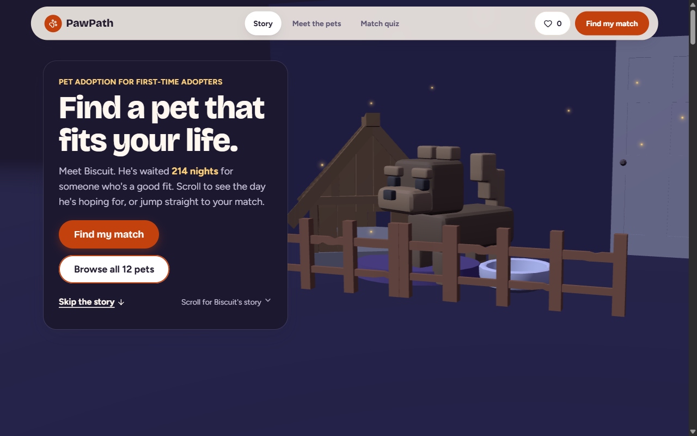
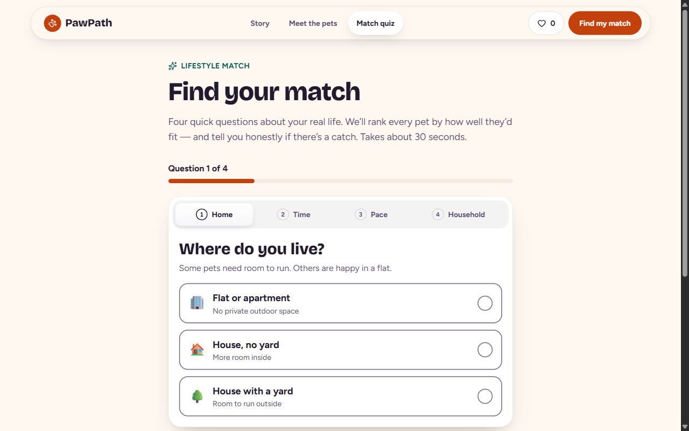
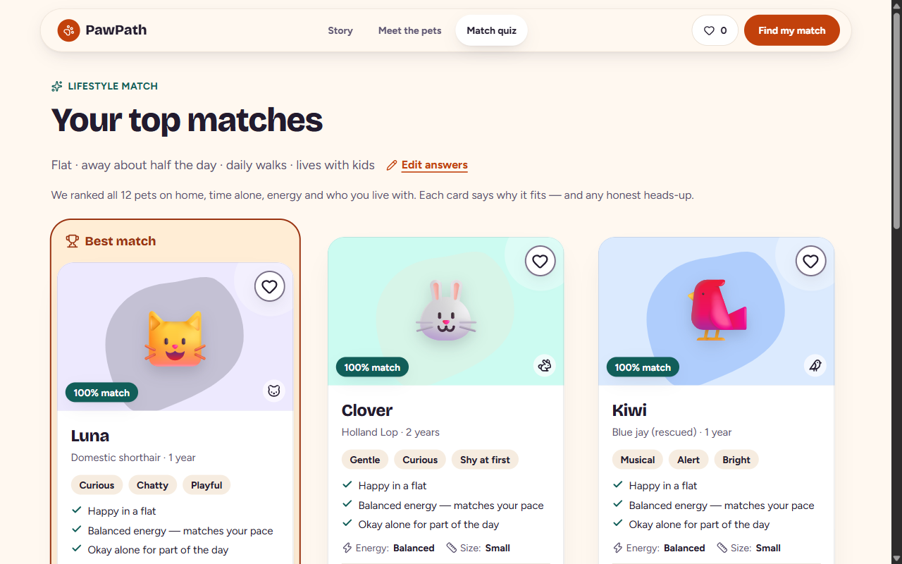
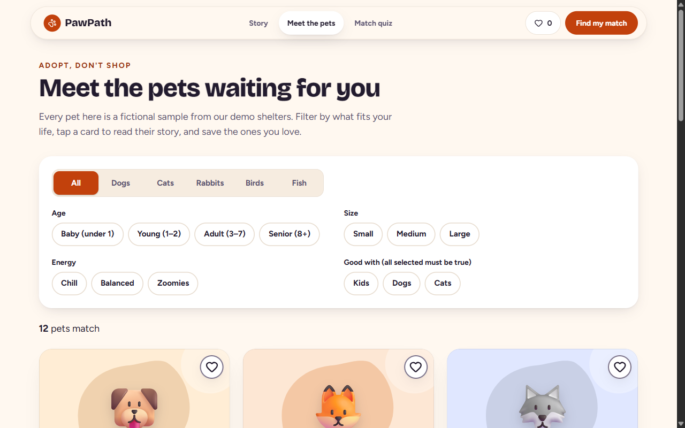
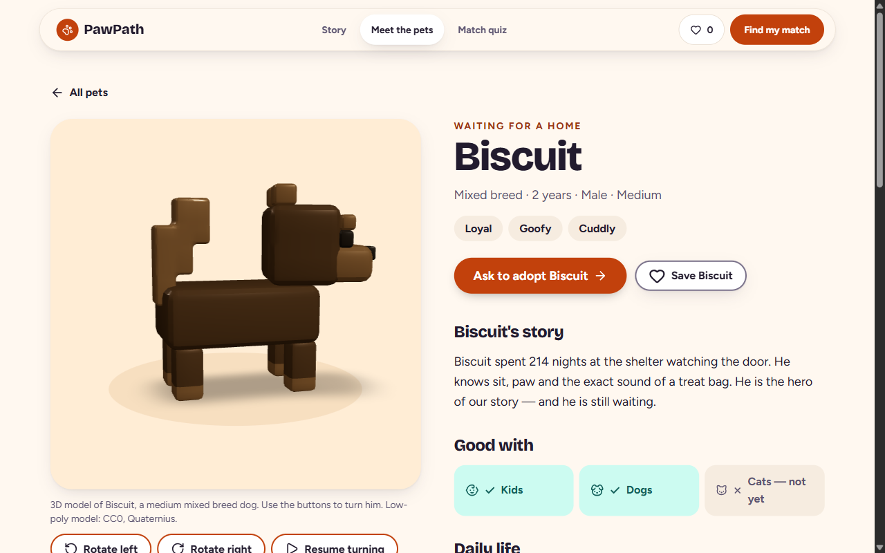
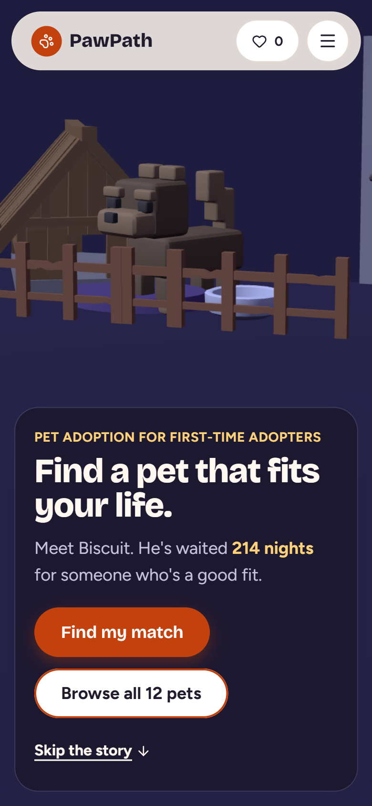
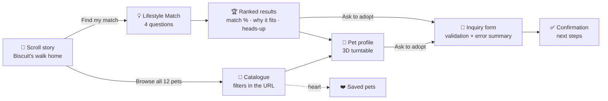

<div align="center">


# PawPath

### Find a pet that fits your life.

A gentle guide for first-time adopters: follow Biscuit the shelter dog home in a scroll-driven 3D story,<br/>
answer four honest questions, and send an adoption inquiry to the pet that truly fits.

[](https://pawpath-one.vercel.app)
[](#at-a-glance)


[**Live demo**](https://pawpath-one.vercel.app) ·
[**Run it locally**](#getting-started) ·
[**Demo script**](docs/DEMO.md) ·
[**AI Iteration Log**](EVALUATION.md#8-ai-iteration-log-this-is-the-originality-score)

<br/>



</div>

> [!IMPORTANT]
> **Demo project.** Every pet, shelter, person, phone number and email on this site is **fictional sample data**.
> No inquiries are sent anywhere and no payments are processed.

---

## Contents

- [At a glance](#at-a-glance)
- [Why PawPath?](#why-pawpath)
- [Screenshots](#screenshots)
- [Key features](#key-features)
- [How it works](#how-it-works)
- [Getting started](#getting-started)
- [Deployment](#deployment)
- [Project structure](#project-structure)
- [Tech stack](#tech-stack)
- [Design choices](#design-choices)
- [Accessibility and responsive checks](#accessibility-and-responsive-checks)
- [AI tools used and what we checked or changed](#ai-tools-used-and-what-we-checked-or-changed)
- [Limitations and next steps](#limitations-and-next-steps)
- [Credits](#credits)
- [Sample data](#sample-data)

---

## At a glance

| | |
|---|---|
| **Brief** | #2 Pet Adoption Platform · ACM MAJU Vibe Coding Competition |
| **Team** | _&lt;Partner 1 name&gt; (&lt;role&gt;)_, _&lt;Partner 2 name&gt; (&lt;role&gt;)_ |
| **Live demo** | <https://pawpath-one.vercel.app> |
| **Repository** | <https://github.com/Ahmedgito/survivor-league> |
| **Audience** | Teens and young adults (16–24) adopting their **first** pet, often living in a flat or with family |
| **Primary task** | Find a pet that fits your life and **send an adoption inquiry** |

## Why PawPath?

First-time adopters tend to choose with their heart, and the most common reason an adoption fails is a
**lifestyle mismatch**: a husky in a small flat, or a kitten left alone all day. PawPath keeps the emotional pull
(Biscuit's story), then turns it into an honest fit check. Every match explains **why** a pet fits you and gives
one **heads-up**, before you ever fill in a form.

## Screenshots

<table>
  <tr>
    <td width="50%" valign="top">
      
      <p align="center"><b>Lifestyle Match</b>: four quick questions</p>
    </td>
    <td width="50%" valign="top">
      
      <p align="center"><b>Ranked results</b>: match %, why it fits, heads-up</p>
    </td>
  </tr>
  <tr>
    <td width="50%" valign="top">
      
      <p align="center"><b>Catalogue</b>: filters that live in the URL</p>
    </td>
    <td width="50%" valign="top">
      
      <p align="center"><b>Pet profile</b>: 3D turntable and adoption details</p>
    </td>
  </tr>
</table>

<div align="center">
  
  <p><b>Mobile-first</b>: tested at 360 and 390 px wide</p>
</div>

## Key features

| | Feature | What it does |
|:--:|---|---|
| ✨ | **Interactive intro loader** | On the first visit, Biscuit sleeps under a waxing moon while the 3D world loads. Move the pointer as a firefly lantern and boop him by click, tap or keyboard. Progress tracks real loading (fonts, the 3D code, model bytes), then an iris wipe opens into the live 3D story. There's a Skip button and an 8-second cap. |
| 🌙 | **Immersive scroll story** | Biscuit the shelter dog's journey home, told in low-poly 3D as you scroll (Lenis smooth scroll + GSAP ScrollTrigger + React Three Fiber). It ends on a clear **"Find my match"** call to action. |
| 💡 | **Lifestyle Match quiz** | Four questions (home, time at home, energy, who you live with). Every pet is ranked with a match %, up to 3 "why it fits" reasons and one honest "heads-up". |
| 🔎 | **Pet catalogue** | Filter by species, age, size, energy and good with kids, dogs or cats. Filters live in the URL, and the results count is announced to screen readers. |
| 📸 | **Real HD pet photos** | Every pet card and profile shows a matching HD photo (800 or 1600px WebP, responsive `srcset`, descriptive alt text). The photographer is credited on each profile. |
| 🐾 | **Pet profiles** | An HD photo with a **Photo / 3D model** toggle (a 3D turntable with Rotate and Pause controls), personality traits and adoption details (fee, vaccinated, neutered, fictional shelter). |
| 📝 | **Adoption inquiry form** | Inline validation, an error summary, a simulated sending state, and a confirmation with next steps. |
| ❤️ | **Saved pets** | Heart any pet. The count shows in the navbar and on `/saved`, with a toast and Undo. |

## How it works

### The main flow



### How a match is scored

Matching is a small, explainable function ([`src/features/match/matching.ts`](src/features/match/matching.ts)). Each pet gets a score out of 100:

| Factor | Points | Full points when… |
|---|:--:|---|
| 🏠 **Home** | 30 | Your home is at least as roomy as the pet needs. More space never costs points. |
| 🕒 **Time with company** | 25 | You're home as much as the pet needs (12 if you're one step short). |
| ⚡ **Pace** | 30 | Your energy matches the pet's (15 if one step apart). |
| 👨‍👩‍👧 **Household** | 15 | The pet is good with everyone you live with: kids, dogs or cats. |

Factors that earn full points become the **"why it fits"** reasons (up to 3). The factor that loses the most points becomes the **heads-up**.

### Routes

| Route | Page |
|---|---|
| `/` | Scroll story (landing) |
| `/pets` | Pet catalogue with filters |
| `/pets/:id` | Pet profile, e.g. [`/pets/biscuit`](https://pawpath-one.vercel.app/pets/biscuit) |
| `/match` | Lifestyle Match quiz |
| `/match/results` | Ranked matches (answers are kept in the URL, so results can be shared) |
| `/adopt/:petId` | Adoption inquiry form |
| `/saved` | Saved pets |

## Getting started

### Prerequisites

| Tool | Version | Check with |
|---|---|---|
| [Node.js](https://nodejs.org) | **20.19+** or **22.12+** (required by Vite 8; built on Node 24) | `node -v` |
| npm | 10+ (ships with Node) | `npm -v` |
| Git | any recent version | `git --version` |
| Browser | any modern browser with WebGL for the 3D story | — |

No backend, database, environment variables or API keys are needed.

### Run it locally

```bash
# 1. Clone the repository
git clone https://github.com/Ahmedgito/survivor-league.git
cd survivor-league

# 2. Install dependencies (npm ci gives an exact install from package-lock.json)
npm ci

# 3. Start the dev server
npm run dev
```

Then open **<http://localhost:5173>** in your browser. 🎉

### Available scripts

| Command | What it does |
|---|---|
| `npm run dev` | Starts the Vite dev server with hot reload at `http://localhost:5173` |
| `npm run build` | Type-checks (`tsc -b`) and builds a production bundle into `dist/` |
| `npm run preview` | Serves the production build locally at `http://localhost:4173` |
| `npm run lint` | Lints the code with [oxlint](https://oxc.rs) |

### Troubleshooting

<details>
<summary><b>"Vite requires Node.js version 20.19+ or 22.12+"</b></summary>

Your Node version is too old. Install the current LTS from [nodejs.org](https://nodejs.org) (or run `nvm install --lts`), then delete `node_modules` and run `npm ci` again.
</details>

<details>
<summary><b>The 3D story shows still pictures instead of animating</b></summary>

Your browser has WebGL turned off or unavailable, so PawPath shows a static, readable version of the story instead. Turn on hardware acceleration in your browser settings, then reload.
</details>

<details>
<summary><b>Refreshing a page like <code>/pets/biscuit</code> gives a 404 after deploying</b></summary>

PawPath is a single-page app, so every route has to be served by `index.html`. This is already set up for Vercel (`vercel.json`) and Netlify (`public/_redirects`). On any other host, add a rewrite from `/*` to `/index.html`.
</details>

<details>
<summary><b>The build warns that some chunks are larger than 500 kB</b></summary>

This is expected and safe to ignore. The 3D engine and models are split into their own chunks and are lazy-loaded only on the story and profile pages.
</details>

## Deployment

The repo is ready to deploy as a static site. The live demo runs on **Vercel**.

| Host | Steps |
|---|---|
| **Vercel** (used for the live demo) | Import the repo at [vercel.com/new](https://vercel.com/new). `vercel.json` already sets the Vite framework, `npm run build`, the `dist` output folder and the SPA rewrites. |
| **Netlify** | Build command `npm run build`, publish directory `dist`. `public/_redirects` handles the SPA routing. |
| **Any static host** | Run `npm run build` and upload the `dist/` folder. Add a `/* → /index.html` rewrite. |

[](https://vercel.com/new/clone?repository-url=https://github.com/Ahmedgito/survivor-league)

## Project structure

```text
survivor-league/
├── public/
│   ├── models/            # 15 optimized low-poly GLB models (pets, props, scenery)
│   ├── _redirects         # Netlify SPA routing
│   └── favicon.svg
├── src/
│   ├── app/               # Layout, navbar, smooth scroll, 404 page
│   ├── experience/        # The immersive 3D scroll story (scene, chapters, timeline)
│   ├── features/
│   │   ├── pets/          # Catalogue, profile, 3D turntable, saved pets
│   │   ├── match/         # Lifestyle Match quiz and scoring
│   │   └── adopt/         # Adoption inquiry form
│   ├── components/
│   │   ├── ui/            # Shared Button, Chip, Toast, BottomNav
│   │   ├── reactbits/     # Adapted React Bits animation components
│   │   └── 21st/          # Adapted 21st.dev SegmentedControl
│   ├── data/              # Fictional pets and 3D model metadata
│   └── lib/               # Accessibility helpers, saved-pets storage
├── scripts/               # 3D model inspection and optimization tools
├── docs/                  # Demo script, planning docs and screenshots
├── EVALUATION.md          # Judging rubric, checklists and the AI Iteration Log
└── vercel.json            # Vercel build and routing config
```

<details>
<summary><b>Re-optimizing the 3D models (optional)</b></summary>

The models in `public/models/` are already optimized, so you only need this if you download new raw models from [Poly Pizza](https://poly.pizza) into `assets-src/raw/`:

```bash
node scripts/optimize-models.mjs                   # assets-src/raw → public/models
node scripts/inspect-models.mjs public/models/*.glb # print clips, sizes and bounds
```

The optimizer strips duplicate animation clips, fixes orientation, and applies meshopt compression (no Draco, so no decoder is fetched from a CDN at runtime).
</details>

## Tech stack

| Layer | Tools |
|---|---|
| **Framework** | React 19, TypeScript, React Router 7 |
| **Build** | Vite 8, oxlint |
| **Styling** | Tailwind CSS 4, with design tokens as CSS variables |
| **3D** | three.js, React Three Fiber, drei; models compressed with gltf-transform + meshopt |
| **Motion** | GSAP ScrollTrigger, Lenis smooth scroll, Motion |
| **Icons and fonts** | Lucide, Bricolage Grotesque, Figtree |
| **Hosting** | Vercel |

## Design choices

- 🎨 **A warm, light palette** (cream, ink, CTA orange `#C2410C`, teal), with every text pair checked at **≥ 4.5:1** contrast (table in [`docs/plan/01-experience.md`](docs/plan/01-experience.md) §4.1).
- 🔤 **Two fonts only:** Bricolage Grotesque for headings and Figtree for body text.
- 📖 **Story text is real HTML** on solid cards, never drawn into the canvas. The 3D layer is decorative (`aria-hidden`) and lazy-loaded.
- 📄 **The inquiry form has its own page** instead of a drawer, so the Back button works and there is no focus trap.
- 🎯 **One dominant action per screen:** "Find my match" → "Ask to adopt {name}" → "Send my inquiry".

## Accessibility and responsive checks

- 📱 Mobile-first, tested at **360 / 390 / 768 / 1280 px** with no horizontal scrolling.
- ⌨️ Fully keyboard-navigable, with visible focus rings and "Skip to content" and "Skip the story" links.
- 🏷️ Labelled form fields with `aria-describedby` errors and an error summary, `aria-pressed` filter chips, and an `aria-live` results count.
- 🖼️ The 3D turntable has a text description, and decorative visuals are hidden from screen readers.
- 🏆 **Lighthouse Accessibility 100** (mobile, 360 px) on `/pets`, `/pets/biscuit`, `/pets/bubbles`, `/match`, `/match/results`, `/adopt/biscuit` and `/saved`. Best Practices 100.
- 🎞️ **Motion:** animations are always on, by team decision, so every visitor gets the scroll story. Some laptops, including ours, report reduced motion by default and would otherwise only show still pictures. All story text is still real HTML, and devices without WebGL get a static, readable version of the story.

## AI tools used and what we checked or changed

**Tools:** Claude Code (Claude Opus) as a team of agents (experience director, 3D asset engineer, component scout, three feature engineers and a QA pass), plus the React Bits and 21st.dev component libraries.

We checked AI output instead of trusting it. Highlights from our [22-entry AI Iteration Log](EVALUATION.md#8-ai-iteration-log-this-is-the-originality-score):

| What the AI produced | What we found | What we changed |
|---|---|---|
| A coral CTA button with white text | Contrast was only **2.8:1** (WCAG needs 4.5:1) | Darkened it to `#C2410C` (**5.18:1**) |
| Shared button styles using `outline-none` | In Tailwind v4 this made keyboard focus **invisible site-wide** | Added a global `:focus-visible` rule and verified it on every control |
| A dog model copied from another public repo | It belongs to Dogstudio; publishing it would redistribute it | Used only CC0 Quaternius and KayKit models, credited below |
| Downloaded 3D models | The bird lay on its side, the Shiba and Husky had duplicated animations, and every model rendered almost black (fully metallic) | Fixed orientation, removed duplicate clips, made materials non-metallic, and compressed each pet to ≤ 302 KB |
| Downloaded animation components | They ignored reduced motion and used click-only, non-keyboard triggers | Added reduced-motion paths and made every trigger keyboard accessible |
| A `matchMedia` override for reduced motion | `"prefers-reduced-motion".includes("reduce")` is **always** true, so other queries were answered wrong | Matched the query value with a regex and tested both queries in the browser |

## Limitations and next steps

**Limitations**
- Inquiries aren't sent anywhere; the form is a front-end demo.
- Pets and shelters are fictional.
- Saved pets persist only in this browser (`localStorage`).
- Visitors who prefer reduced motion can't switch the animations off yet.

**Next steps**
- Real shelter listings through an API.
- A shelter-side inbox for managing inquiries.
- Comparing two pets side by side.
- A motion on/off control.

## Credits

- **3D pets, furniture and scenery:** [Quaternius](https://quaternius.com) (CC0), via [Poly Pizza](https://poly.pizza)
- **Bone and bowl props:** Kay Lousberg / [KayKit](https://kaylousberg.com) (CC0), via Poly Pizza
- **Pet photos:** Priyansh Patidar, Joshua katt, Yaroslava Holiachenko, Дарья Шкаруба, Milada Vigerova, Fernando Vega, Kristin Kenney, Chee Kee, Nikolett Emmert, Dmytro Koplyk, fishy fishy and Reba Spike via [Unsplash](https://unsplash.com) ([Unsplash License](https://unsplash.com/license)). They are stand-ins: every pet is fictional. Per-photo links are in [`docs/plan/05-photos.md`](docs/plan/05-photos.md).
- **UI components:** adapted from [React Bits](https://reactbits.dev) by David Haz (MIT + Commons Clause) and [21st.dev](https://21st.dev) (SegmentedControl by ddoemonn, MIT)
- **Icons:** [Lucide](https://lucide.dev) (ISC)
- **Fonts:** Bricolage Grotesque and Figtree via [Google Fonts](https://fonts.google.com) (OFL)
- **Libraries:** React, Tailwind CSS, Lenis, GSAP, three.js, React Three Fiber, drei, Motion, React Router
- **Screenshots:** taken from the live demo

## Sample data

All people, pets, shelters, prices and contact details are **fictional** and for demonstration only ([`src/data/pets.ts`](src/data/pets.ts)).
Contact emails use the reserved `example.com` domain. No real personal, student or health information is used. No payments are processed.

---

<div align="center">

Made with 🧡 for the **ACM MAJU Vibe Coding Competition**

<sub>Biscuit is still waiting. <a href="https://pawpath-one.vercel.app">Go find your match →</a></sub>

</div>
